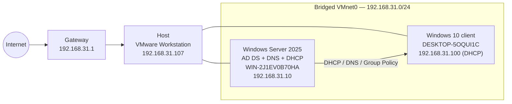
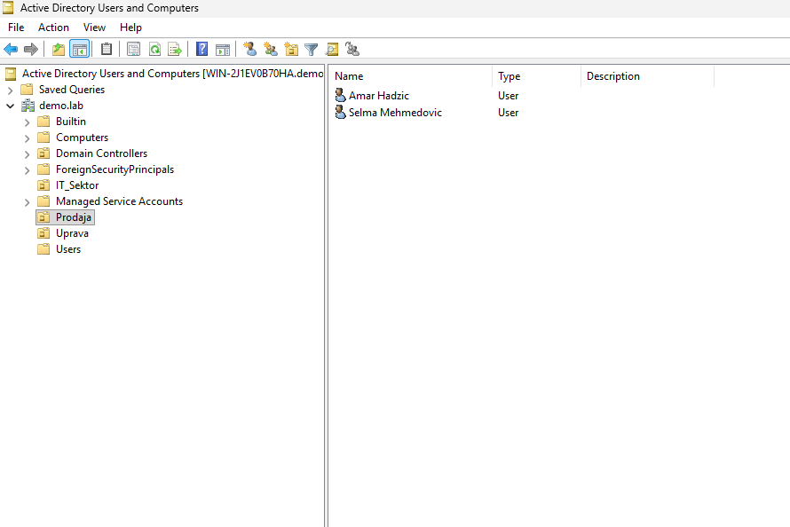
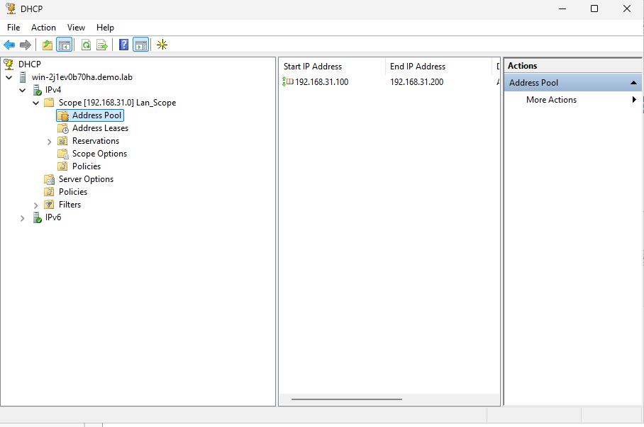
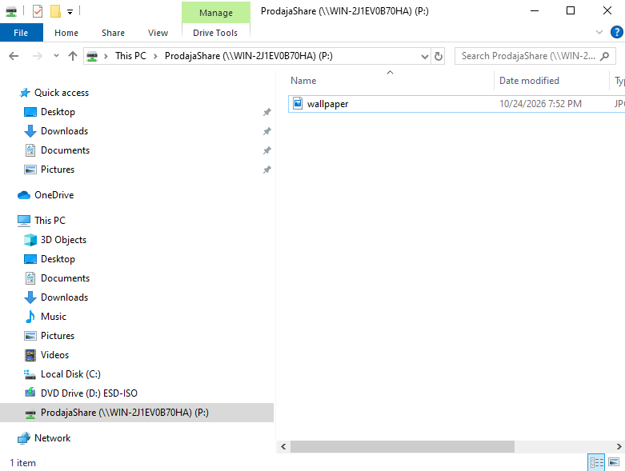

# Active Directory & Enterprise Domain Infrastructure

Active Directory lab built on VMware Workstation: a Windows Server 2025 domain
controller providing AD DS, DNS and DHCP for the `demo.lab` domain, with
Organizational Units, users provisioned from CSV, and Group Policy.


---

## Overview

This repository documents a self-contained Windows enterprise lab:

- **Windows Server 2025** is the identity provider — AD DS, DNS and DHCP for the
  `demo.lab` domain.
- **Windows 10** client receives its address from DHCP and applies domain GPOs.
- **Users and OUs** are provisioned from a CSV file with a PowerShell script.
- **Group Policy** controls the desktop wallpaper, Control Panel access and
  network drive mapping.

> The three things that make the domain work: a **stable identity** (static IP +
> hostname), **DNS that points at the DC**, and **accurate time** (Kerberos
> tolerates at most five minutes of clock skew).

## Architecture



## Environment

| Component | Value |
|---|---|
| Domain | `demo.lab` |
| NetBIOS name | `DEMO` |
| Distinguished name | `DC=demo,DC=lab` |
| Domain functional level | Windows Server 2025 |
| Domain controller | `WIN-2J1EV0B70HA` — `192.168.31.10` |
| DC operating system | Windows Server 2025 Datacenter Evaluation |
| Client | `DESKTOP-5OQUI1C` — `192.168.31.100` (DHCP) |
| Gateway | `192.168.31.1` |
| Virtualization | VMware Workstation, **bridged** (VMnet0) |

## Network plan

| Role | Host | IP address | Notes |
|---|---|---|---|
| Router / gateway | home network | `192.168.31.1` | internet egress |
| Host | Windows + VMware Workstation | `192.168.31.107` | physical, wired |
| Domain controller + DNS + DHCP | `WIN-2J1EV0B70HA` | `192.168.31.10` | bridged |
| Client | `DESKTOP-5OQUI1C` | `192.168.31.100` | DHCP lease |

## DNS

Zones hosted on the DC:

| Zone | Type |
|---|---|
| `demo.lab` | Primary (AD-integrated) |
| `_msdcs.demo.lab` | Primary |
| `0.in-addr.arpa`, `127.in-addr.arpa`, `255.in-addr.arpa` | Reverse lookup |

Forward A records in `demo.lab`:

| Host | IP |
|---|---|
| `@` | `192.168.31.10` |
| `win-2j1ev0b70ha` | `192.168.31.10` |
| `DESKTOP-5OQUI1C` | `192.168.31.100` |
| `DomainDnsZones` | `192.168.31.10` |
| `ForestDnsZones` | `192.168.31.10` |

External names are resolved through a forwarder to `192.168.31.1`:

```powershell
Set-DnsServerForwarder -IPAddress 192.168.31.1
```

## DHCP

| Setting | Value |
|---|---|
| Scope | `Lan_Scope` — `192.168.31.0/24` |
| Address range | `192.168.31.100` – `192.168.31.200` |
| State | Active |
| Authorised in AD | Yes — `192.168.31.10` / `win-2j1ev0b70ha.demo.lab` |
| Option 3 — Router | `192.168.31.1` |
| Option 6 — DNS | `192.168.31.10` |
| Option 15 — Domain name | `demo.lab` |
| Option 51 — Lease time | `691200` s (8 days) |

## Organizational units

```text
DC=demo,DC=lab
├── OU=IT_Sektor
├── OU=Prodaja
├── OU=Uprava
└── OU=Domain Controllers
```

## Users

Users are provisioned from [`data/korisnici.csv`](data/korisnici.csv) with
[`scripts/windows/Import-ADUsers.ps1`](scripts/windows/Import-ADUsers.ps1).

| Name | sAMAccountName | OU | Department |
|---|---|---|---|
| Amar Hadzic | `ahadzic` | `Prodaja` | Prodaja |
| Lejla Kovacevic | `lkovacevic` | `Uprava` | Uprava |
| Tarik Delic | `tdelic` | `IT_Sektor` | IT |
| Selma Mehmedovic | `smehmedovic` | `Prodaja` | Prodaja |
| Haris Sokolovic | `hsokolovic` | `IT_Sektor` | IT |
| Nejra Imamovic | `nimamovic` | `Uprava` | Uprava |

**CSV schema**

```csv
Firstname,Lastname,Username,OU,Department
Amar,Hadzic,ahadzic,Prodaja,Prodaja
```

Save the file as **UTF-8 with BOM** so that Windows PowerShell 5.1 reads
non-ASCII characters correctly.

## Group Policy

| GPO | Status | Purpose |
|---|---|---|
| `Default Domain Policy` | Enabled | Domain baseline |
| `Default Domain Controllers Policy` | Enabled | DC baseline |
| `GPO_Wallpaper` | Enabled | Corporate desktop wallpaper |
| `GPO_Zabrana_ControlPanel` | Enabled | Blocks Control Panel for standard users |
| `GPO_Drive_Mapping_Prodaja` | Enabled | Maps `P:` to `\\WIN-2J1EV0B70HA\ProdajaShare` for the `Prodaja` OU via Group Policy Preferences |

## Drive mapping

Users in `OU=Prodaja` receive a mapped network drive through
`GPO_Drive_Mapping_Prodaja` (User Configuration → Preferences → Windows
Settings → Drive Maps).

| Setting | Value |
|---|---|
| Drive letter | `P:` |
| Location | `\\WIN-2J1EV0B70HA\ProdajaShare` |
| Local folder | `C:\ProdajaShare` on the DC |
| Action | Update |
| Scope | Users in `OU=Prodaja` |

The share is created on the domain controller with
[`scripts/windows/Setup-ProdajaShare.ps1`](scripts/windows/Setup-ProdajaShare.ps1):

```powershell
.\scripts\windows\Setup-ProdajaShare.ps1
```

For lab simplicity the share is hosted on the DC; in production it would live on
a dedicated member file server.

## Automation

Create the users from the CSV:

```powershell
# dry run first
.\scripts\windows\Import-ADUsers.ps1 `
    -CsvPath .\data\korisnici.csv `
    -DomainDN "DC=demo,DC=lab" `
    -WhatIf

# then for real (you will be prompted for the initial password)
.\scripts\windows\Import-ADUsers.ps1 `
    -CsvPath .\data\korisnici.csv `
    -DomainDN "DC=demo,DC=lab"
```

Create the `Prodaja` file share used by the drive-mapping GPO:

```powershell
.\scripts\windows\Setup-ProdajaShare.ps1
```

Collect a read-only inventory of the whole lab:

```powershell
.\scripts\windows\Get-ADLabReport.ps1 -CsvPath .\data\korisnici.csv
```

The report is written to the current user's Desktop and copied to the clipboard.

## Evidence

| ADUC OU structure | DHCP scope authorised | Mapped network drive |
|---|---|---|
|  |  |  |

## Project status

| Item | Status |
|---|---|
| Windows Server deployed as domain controller | ✅ Done |
| Static network, gateway and DNS forwarder | ✅ Done |
| DNS zones and A records | ✅ Done |
| DHCP scope and AD authorisation | ✅ Done |
| Organizational Units (`IT_Sektor`, `Prodaja`, `Uprava`) | ✅ Done |
| Users provisioned from CSV | ✅ Done |
| Group Policy (wallpaper, Control Panel, drive mapping) | ✅ Done |
| File share `ProdajaShare` on the DC | ✅ Done |
| Security groups and group-based access | ⬜ Pending |
| Test plan and final documentation | ⬜ Pending |

### Roadmap

1. Create security groups `IT_Sektor`, `Prodaja` and `Uprava` and populate them.
2. Replace OU-only access separation with group-based permissions.
3. Document the GPO-to-OU links and verify with `gpresult /r`.
4. Add a test plan (domain logon, GPO application, drive mapping, denied access).
5. Capture the final screenshots and update the documentation.

## Known issues

- **No custom security groups yet.** Access separation is currently OU-based
  only; the default AD groups are the only ones present. Planned as part of the
  roadmap.
- **Default password policy is in use.** No fine-grained password policy has been
  configured for the lab.
- **No AD backup or Recycle Bin verification yet.**

## Security notes

- This is a **lab environment**. Never reuse these settings in production.
- No credentials or passwords are stored in this repository.
- Administrative accounts must be used only for administration; day-to-day
  accounts must be standard users.
- VM disks (`.vmdk`), NVRAM files and VMware logs are excluded by
  [`.gitignore`](.gitignore) and must never be committed.

## Repository layout

```text
.
├── README.md                  # this file
├── README.sr.md               # Serbian version
├── LICENSE                    # MIT (code) + CC BY 4.0 (docs)
├── .gitignore
├── .gitattributes
├── .markdownlint.json
├── data/
│   └── korisnici.csv          # user provisioning input
├── docs/
│   └── troubleshooting.md     # issues and fixes
├── scripts/
│   └── windows/
│       ├── Import-ADUsers.ps1
│       ├── Get-ADLabReport.ps1
│       └── Setup-ProdajaShare.ps1
├── screenshots/
└── .github/workflows/lint.yml
```

## License

Source code is licensed under the **MIT License**. Documentation is licensed
under **CC BY 4.0**. See [LICENSE](LICENSE).
