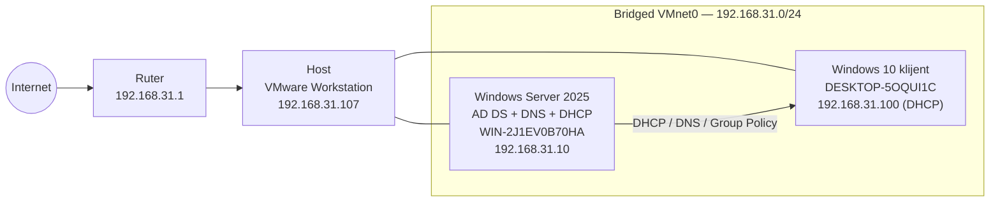
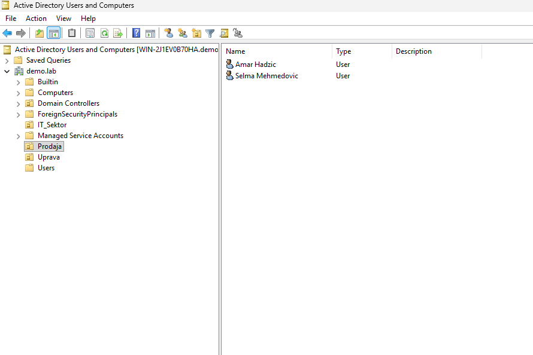
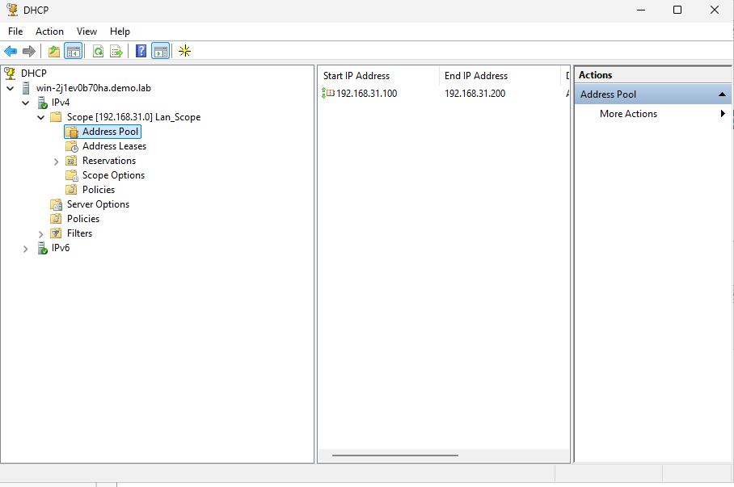
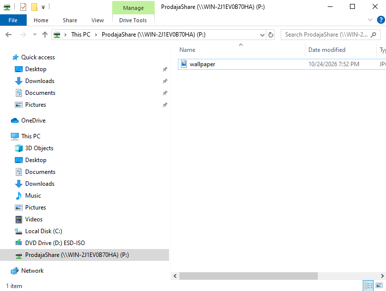

# Active Directory & Enterprise Domain Infrastructure

Active Directory laboratorija napravljena na VMware Workstation-u: Windows Server
2025 domenski kontroler sa AD DS, DNS i DHCP servisima za domen `demo.lab`,
organizacionim jedinicama, korisnicima kreiranim iz CSV-a i Group Policy
politikama.


---

## Pregled

Repozitorijum dokumentuje zaokruzeno Windows enterprise okruzenje:

- **Windows Server 2025** je izvor identiteta — AD DS, DNS i DHCP za domen
  `demo.lab`.
- **Windows 10** klijent dobija adresu preko DHCP-a i prima domenske GPO.
- **Korisnici i OU** se kreiraju iz CSV fajla pomocu PowerShell skripte.
- **Group Policy** kontrolise pozadinu radne povrsine, pristup Control Panel-u i
  mapiranje mreznog drajva.

> Tri stvari koje drze domen funkcionalnim: **stalan identitet** (fiksna IP +
> ime), **DNS koji pokazuje na DC** i **tacno vreme** (Kerberos tolerise najvise
> pet minuta odstupanja).

## Arhitektura



## Okruzenje

| Komponenta | Vrednost |
|---|---|
| Domen | `demo.lab` |
| NetBIOS ime | `DEMO` |
| Distinguished name | `DC=demo,DC=lab` |
| Functional level domena | Windows Server 2025 |
| Domenski kontroler | `WIN-2J1EV0B70HA` — `192.168.31.10` |
| OS domenskog kontrolera | Windows Server 2025 Datacenter Evaluation |
| Klijent | `DESKTOP-5OQUI1C` — `192.168.31.100` (DHCP) |
| Gateway | `192.168.31.1` |
| Virtualizacija | VMware Workstation, **bridged** (VMnet0) |

## Mrezni plan

| Uloga | Masina | IP adresa | Napomena |
|---|---|---|---|
| Ruter / gateway | kucna mreza | `192.168.31.1` | izlaz u internet |
| Host | Windows + VMware Workstation | `192.168.31.107` | fizicka mreza, wired |
| Domenski kontroler + DNS + DHCP | `WIN-2J1EV0B70HA` | `192.168.31.10` | bridged |
| Klijent | `DESKTOP-5OQUI1C` | `192.168.31.100` | DHCP lease |

## DNS

Zone na domenskom kontroleru:

| Zona | Tip |
|---|---|
| `demo.lab` | Primary (AD-integrated) |
| `_msdcs.demo.lab` | Primary |
| `0.in-addr.arpa`, `127.in-addr.arpa`, `255.in-addr.arpa` | Reverse lookup |

A zapisi u zoni `demo.lab`:

| Host | IP |
|---|---|
| `@` | `192.168.31.10` |
| `win-2j1ev0b70ha` | `192.168.31.10` |
| `DESKTOP-5OQUI1C` | `192.168.31.100` |
| `DomainDnsZones` | `192.168.31.10` |
| `ForestDnsZones` | `192.168.31.10` |

Spoljna imena se razresavaju preko forwardera ka `192.168.31.1`:

```powershell
Set-DnsServerForwarder -IPAddress 192.168.31.1
```

## DHCP

| Postavka | Vrednost |
|---|---|
| Scope | `Lan_Scope` — `192.168.31.0/24` |
| Opseg adresa | `192.168.31.100` – `192.168.31.200` |
| Stanje | Active |
| Autorizovan u AD | Da — `192.168.31.10` / `win-2j1ev0b70ha.demo.lab` |
| Opcija 3 — Router | `192.168.31.1` |
| Opcija 6 — DNS | `192.168.31.10` |
| Opcija 15 — Ime domena | `demo.lab` |
| Opcija 51 — Trajanje lease-a | `691200` s (8 dana) |

## Organizacione jedinice

```text
DC=demo,DC=lab
├── OU=IT_Sektor
├── OU=Prodaja
├── OU=Uprava
└── OU=Domain Controllers
```

## Korisnici

Korisnici se kreiraju iz [`data/korisnici.csv`](data/korisnici.csv) pomocu
[`scripts/windows/Import-ADUsers.ps1`](scripts/windows/Import-ADUsers.ps1).

| Ime | sAMAccountName | OU | Sektor |
|---|---|---|---|
| Amar Hadzic | `ahadzic` | `Prodaja` | Prodaja |
| Lejla Kovacevic | `lkovacevic` | `Uprava` | Uprava |
| Tarik Delic | `tdelic` | `IT_Sektor` | IT |
| Selma Mehmedovic | `smehmedovic` | `Prodaja` | Prodaja |
| Haris Sokolovic | `hsokolovic` | `IT_Sektor` | IT |
| Nejra Imamovic | `nimamovic` | `Uprava` | Uprava |

**Shema CSV fajla**

```csv
Firstname,Lastname,Username,OU,Department
Amar,Hadzic,ahadzic,Prodaja,Prodaja
```

Sacuvaj fajl kao **UTF-8 with BOM** da bi Windows PowerShell 5.1 ispravno
procitao ne-ASCII karaktere.

## Group Policy

| GPO | Status | Namena |
|---|---|---|
| `Default Domain Policy` | Enabled | Osnovna politika domena |
| `Default Domain Controllers Policy` | Enabled | Osnovna politika za DC |
| `GPO_Wallpaper` | Enabled | Pozadina radne povrsine |
| `GPO_Zabrana_ControlPanel` | Enabled | Zabrana Control Panel-a standardnim korisnicima |
| `GPO_Drive_Mapping_Prodaja` | Enabled | Mapira `P:` na `\\WIN-2J1EV0B70HA\ProdajaShare` za `Prodaja` OU preko Group Policy Preferences |

## Mapiranje drajva

Korisnici u `OU=Prodaja` dobijaju mrezni drajv preko
`GPO_Drive_Mapping_Prodaja` (User Configuration → Preferences → Windows
Settings → Drive Maps).

| Postavka | Vrednost |
|---|---|
| Slovna oznaka | `P:` |
| Lokacija | `\\WIN-2J1EV0B70HA\ProdajaShare` |
| Lokalni folder | `C:\ProdajaShare` na DC-u |
| Akcija | Update |
| Obuhvat | Korisnici u `OU=Prodaja` |
| Share dozvole | `DEMO\Domain Users` — Read, `DEMO\Domain Admins` — Full |
| NTFS dozvole | `DEMO\Domain Users` — Read & execute, `DEMO\Domain Admins` — Full control |

Share se pravi na domenskom kontroleru pomocu
[`scripts/windows/Setup-ProdajaShare.ps1`](scripts/windows/Setup-ProdajaShare.ps1):

```powershell
.\scripts\windows\Setup-ProdajaShare.ps1
```

Za potrebe laba share je na DC-u; u produkciji bi bio na namenskom file serveru.

## Automatizacija

Kreiranje korisnika iz CSV-a:

```powershell
# probni prolaz
.\scripts\windows\Import-ADUsers.ps1 `
    -CsvPath .\data\korisnici.csv `
    -DomainDN "DC=demo,DC=lab" `
    -WhatIf

# pravo kreiranje (lozinka se unosi interaktivno)
.\scripts\windows\Import-ADUsers.ps1 `
    -CsvPath .\data\korisnici.csv `
    -DomainDN "DC=demo,DC=lab"
```

Napravi `Prodaja` file share koji koristi GPO za mapiranje drajva:

```powershell
.\scripts\windows\Setup-ProdajaShare.ps1
```

Read-only inventar celog okruzenja:

```powershell
.\scripts\windows\Get-ADLabReport.ps1 -CsvPath .\data\korisnici.csv
```

Izvestaj se upisuje na Desktop i kopira u clipboard.

## Dokazi

| ADUC struktura OU | DHCP scope autorizovan | Mapiran mrezni drajv |
|---|---|---|
|  |  |  |

## Status projekta

| Stavka | Status |
|---|---|
| Windows Server postavljen kao domenski kontroler | ✅ Gotovo |
| Staticka mreza, gateway i DNS forwarder | ✅ Gotovo |
| DNS zone i A zapisi | ✅ Gotovo |
| DHCP scope i autorizacija u AD | ✅ Gotovo |
| Organizacione jedinice (`IT_Sektor`, `Prodaja`, `Uprava`) | ✅ Gotovo |
| Korisnici kreirani iz CSV-a | ✅ Gotovo |
| Group Policy (pozadina, Control Panel, mapiranje drajva) | ✅ Gotovo |
| File share `ProdajaShare` na DC-u | ✅ Gotovo |
| Security grupe i pristup po grupama | ⬜ Sledi |
| Test plan i finalna dokumentacija | ⬜ Sledi |

### Plan daljih koraka

1. Napraviti security grupe `IT_Sektor`, `Prodaja` i `Uprava` i popuniti ih.
2. Zameniti razdvajanje samo po OU pristupom po grupama.
3. Dokumentovati GPO linkove ka OU i proveriti sa `gpresult /r`.
4. Dodati test plan (domenska prijava, primena GPO, mapiranje drajva, zabrana pristupa).
5. Uslikati finalne screenshot-ove i azurirati dokumentaciju.

## Poznati problemi

- **Jos nema custom security grupa.** Razdvajanje je trenutno samo po OU; postoje
  samo podrazumevane AD grupe. Planirano kroz roadmap.
- **Koristi se podrazumevana password policy.** Nema fine-grained password policy
  za lab.
- **Nema AD backup-a ni provere Recycle Bin-a.**

## Bezbednosne napomene

- Ovo je **laboratorijsko okruzenje**. Nikada ne koristiti ove postavke u produkciji.
- U repozitorijumu nema kredencijala ni lozinki.
- Administrativni nalozi sluze samo za administraciju; svakodnevni rad ide preko
  standardnih korisnickih naloga.
- VM diskovi (`.vmdk`), NVRAM fajlovi i VMware logovi su izuzeti preko
  [`.gitignore`](.gitignore) i nikada se ne commituju.

## Struktura repozitorijuma

```text
.
├── README.md                  # engleski
├── README.sr.md               # srpski
├── LICENSE                    # MIT (kod) + CC BY 4.0 (dokumentacija)
├── .gitignore
├── .gitattributes
├── .markdownlint.json
├── data/
│   └── korisnici.csv          # ulaz za kreiranje korisnika
├── docs/
│   └── troubleshooting.md     # problemi i resenja
├── scripts/
│   └── windows/
│       ├── Import-ADUsers.ps1
│       ├── Get-ADLabReport.ps1
│       └── Setup-ProdajaShare.ps1
├── screenshots/
└── .github/workflows/lint.yml
```

## Licenca

Izvorni kod je pod **MIT licencom**. Dokumentacija je pod **CC BY 4.0**
licencom. Vidi [LICENSE](LICENSE).
